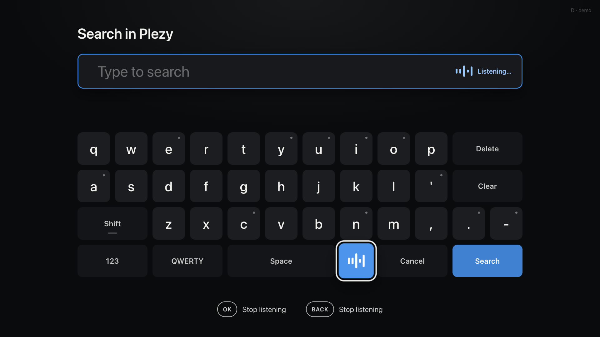
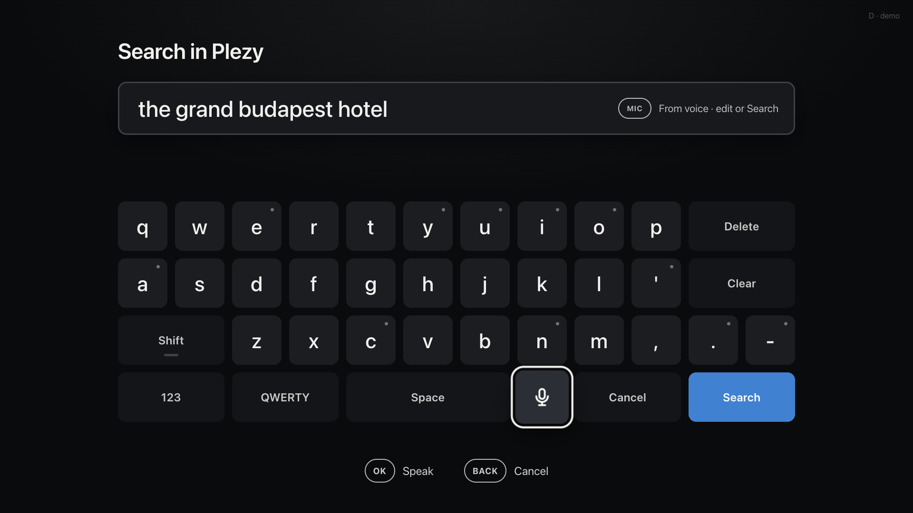

# Couch Linux: a media-center layer for Steam Big Picture on a TV


A Linux PC in front of a TV can be a very good media center, and Steam Big Picture is a very good front door for it. What it lacks is the
living-room layer: a remote that works everywhere, a way to switch or kill apps without a mouse, a keyboard you can use from the sofa,
the TV's own volume and inputs, and proof that your sound is untouched. This repository is that layer, for **KDE Plasma on Wayland**
(tested on Bazzite). Nothing in it is specific to one remote, one app or one TV.

It started as the setup of one person who replaced a Shield with a gaming PC, and it is still shaped by that setup: **Steam Big Picture** as the
launcher, **[Plezy](https://github.com/edde746/plezy)** for the Plex library and **[VacuumTube](https://github.com/shy1132/VacuumTube)** for YouTube,
driven by a **JZK G20S Pro Plus** remote. Other remotes and other apps are supported by design, and adding yours is meant to be easy:
see [Adding an app](docs/adding-an-app.md).

## What you get

* **A remote mapper for any remote.** A wizard asks you to press the button for each function (arrows, OK, Back, Home, Power, volume, mic, media keys...) and writes the remap. Every remote then behaves the same way. 2.4 GHz dongles and Bluetooth remotes both work.
* **TV control.** Power, volume and mute go to the **TV** (through Home Assistant or any command), not to the PC. The PC never suspends because of the Power key.
* **An app switcher with a kill button.** Cards of the open windows with live screenshots; OK brings one forward, hold OK for 3 seconds to kill a frozen app.
* **A TV input picker.** Choose HDMI 1, 2, 3... from the sofa; the TV switches.
* **An on-screen keyboard that finds the search field by itself,** for apps that have none. It opens when OK lands on a text field, or from the mic key.
* **Voice search** in your language, from the same keyboard or with one press of the mic key, typed into the search box of Steam, Plezy, VacuumTube and more.
* **Notices and a scene button.** A transparent overlay confirms a Home Assistant scene ("Movie time") for 3 seconds without stealing focus.
* **A bit-perfect sound checklist.** When a film starts, a toast tells you whether the soundtrack reaches the receiver untouched.
* **Optional idle power saving** that keeps the PC ready and uses the minimum when nothing needs it.

## What it looks like

| | |
|---|---|
|  | **App switcher**: cards of the open windows with live pictures. OK opens, OK held 3 s closes a frozen app. |
|  | **TV input picker**: choose the HDMI input with the D-pad, the TV switches through Home Assistant. |
|  | **On-screen keyboard** for searches (D-pad or air mouse, accents, AZERTY/QWERTY/QWERTZ). |
|  | **Voice search**: press the mic key, the keyboard opens already listening and stops when you stop talking. |
|  | The words land in the field. With auto-submit on (the default) the search then runs in the app, without a press on Search. |
|  | **Quality checklist** when a film starts: untouched Dolby TrueHD bitstream, lossless, 4K 60 Hz. Amber when something lowers the quality ([more](docs/setup-guide.md)). |
|  | **Scene button**: one press starts a Home Assistant scene, a notice confirms it for 3 seconds. |

**New here? Read the [step-by-step setup guide](docs/setup-guide.md)**: install, teach the remote, TV control through Home Assistant, the pages, voice, lossless sound,
the scene button, every configuration key, ideas and troubleshooting.

## Apps it works with

| App | Home button | Keyboard opens by itself | Voice search typed into |
|---|---|---|---|
| **Steam Big Picture** | yes | yes (Steam's local debug port) | yes, its search field (replaced each time) |
| **Plezy** | yes | yes | yes (Ctrl+F opens its search page first) |
| **VacuumTube** (YouTube for TV) | yes | yes | yes, through its debug port (see [Adding an app](docs/adding-an-app.md)) |
| Any Wayland app with a text field | yes | yes (KDE text-input state) | yes, Ctrl+A then Ctrl+V into the focused field |
| Any Electron or Chromium app | yes | with `--remote-debugging-port` | with `--remote-debugging-port` |

Voice text is only typed when a text field really has the focus, so a stray voice search never presses Enter on a poster. Your app is not in the table?
Everything that is app specific is a few lines in one place; [Adding an app](docs/adding-an-app.md) walks through it, and a pull request that adds one is welcome.

## Quick start

```bash
git clone https://github.com/silkyclouds/g20s-remote-linux && cd g20s-remote-linux
./install.sh
```

`install.sh` first checks what your computer has (and tells you what to install if something is missing), installs everything in your home directory, then runs a **first-run wizard** (it asks for your `sudo` password for the key remap):

1. *Press any button on your remote.* It is identified (2.4 GHz dongle or Bluetooth, any brand).
2. For every function it asks you to **press the matching button**: Up, Down, Left, Right, OK, Back, Home, Power, Volume +, Volume -, Mute, Mic/Search,
   Play/Pause, Rewind, Fast-forward, and the **Source** button, the **app switcher** and previous/next window. **No such button? Press Escape on your keyboard** (in the terminal) to skip it.
3. It writes the remap, then asks (optional) for your Home Assistant webhook and your voice languages.
4. **Unplug and replug the dongle** (or reconnect the Bluetooth remote) once, and you are done.

If you own the **JZK G20S Pro Plus with its dongle**, the wizard recognises it and offers the tested mapping in one keypress.

The functions are fixed on purpose, so every remote ends up behaving the same way (table below). Rerun the wizard any time: `sudo bin/g20-setup`.

## The functions

You choose which button of **your** remote does each function (the wizard asks); the functions themselves are fixed, so every remote behaves the same way.

| Function | What the PC sees after the remap | What it does |
|---|---|---|
| Up / Down / Left / Right | arrow keys | navigation |
| OK | Enter | select |
| Back | Escape | back |
| Home | `KEY_MACRO1` | raise (or start) your home app, full screen |
| Power | `KEY_PROG1` | toggle the **TV**, and pause any playing media |
| Volume + / - | `KEY_PROG2` / `KEY_PROG3` | **TV** volume (repeats while held) |
| Mute | `KEY_PROG4` | **TV** mute |
| Mic / Search *(optional)* | `KEY_VOICECOMMAND` | on-screen keyboard (+ voice when set up) |
| Play/Pause, Rewind/Previous, Fast-forward/Next | media keys | player control |
| **Source** *(optional)* | `KEY_MACRO5` | **TV input picker** (HDMI 1, 2, 3...): choose with the D-pad, the TV switches through Home Assistant; press again to close |
| **App switcher** *(optional)* | `KEY_MACRO3` | cards of the open windows, with screenshots; press again to close (or raise it if it is behind); never two |
| Previous / next window *(optional)* | `KEY_MACRO2` / `KEY_MACRO4` | like Alt+Tab |
| **Scene** *(optional)* | `KEY_MACRO6` | runs your Home Assistant scene or command, then shows a 3 s notice at the top right (see below) |

`KEY_PROG*` and `KEY_MACRO*` are keys no desktop binds (`F13` would open Quick Settings on KDE), so nothing reacts to them except `g20d`.
Redo the whole mapping with `sudo bin/g20-setup`, or only some functions with `sudo bin/g20-setup --only source,switcher`
(the others keep their button). Names of the functions: `up down left right ok back home power volup voldown mute mic play prev next source switcher prevwin nextwin scene`.

For reference, the tested **G20S Pro Plus dongle** preset (scancode → function): OK `0xc0041`, Back `0xc0224`, Home `0xc0223`, Power `0x10081`,
Vol+ `0xc00e9`, Vol- `0xc00ea`, Mute `0xc00e2`, Mic `0xc00cf`, Play `0xc00cd`, Pg+ `0x7004b` (source), keys 1/2/3 `0x7001e` / `0x7001f` / `0x70020`
(previous window / app switcher / next window).

## The TV input picker


Press your **Source** button: one card per HDMI input, the current one badged. **Left/right** and **OK** (or the air mouse); the TV switches through the
Home Assistant webhook (`media_player.select_source`, see `ha/automation.example.yaml`) or your own command (`G20_CMD_SOURCE`, the id is in `$G20_SOURCE`).
**When the TV is not on the PC's input** you cannot see the picker. With `G20_SOURCE_VIA_HA=1`, Home Assistant tells the PC which input the TV is on: if it is the PC's (`G20_PC_INPUT`, default `hdmi4`), the picker opens; if not, **each press selects the next input blindly** (the TV shows its own banner), until you are back on the PC. See `ha/automation.example.yaml`.
Declare your inputs in `~/.config/g20/g20.conf` (the wizard asks): `G20_SOURCES=hdmi1:Shield,hdmi2:PC,hdmi3:PlayStation,hdmi4`
(ids must match your TV integration's source names; the label is optional).

## The app switcher

Press your **app switcher** button: a full-screen page lists every open window as a card with a live screenshot, the app icon and the title.
**Left/right** move, **OK** brings the window to the front, **hold OK for 3 seconds** kills the app (SIGTERM, then SIGKILL; Steam is relaunched in Big Picture),
**Back** or the same button again closes it. The page is a single HTML file designed with [Claude Design](https://claude.ai/design) and served unmodified;
a small local server lists windows through a KWin script (called back over D-Bus) and takes the screenshots with KWin's `ScreenShot2`.

## The on-screen keyboard


It opens on its own when OK lands on a text field (Steam, Plezy, any Wayland app with text input, any app listed in `G20_CDP_PORTS`), or when you press the **Mic/Search** key.
Move with the D-pad (or the air-mouse pointer), hold OK on a letter for accents. **Search** pastes the text into the app that had the focus (for Plezy, the search page is opened first) and sends Enter.

## Voice search


Press the **Mic** key from anywhere: the keyboard opens already listening. Say what you want, stop talking, and the search runs in the app. Press the key again while it listens to cancel.
The on-screen mic key does the same, from the keyboard itself.

How it works: the daemon `g20-voice` listens to the remote's microphone (with a 2.4 GHz dongle it is an ordinary USB audio input; with a Bluetooth voice remote it comes through
[ATVVoice](https://github.com/b0o/ATVVoice)), stops by itself when you stop talking, sends the recording to a speech recognizer, and hands the words to the keyboard overlay. The overlay types them into the app,
replacing what the field held. The transcript keeps its words only: no full stop, no commas.

**The speech recognizer** is either of these, and both work offline:

* **A Whisper server on your network or on this PC** (`G20_VOICE_BACKEND=http`). Anything that speaks the OpenAI `audio/transcriptions` API will do: the `whisper.cpp` server, faster-whisper-server, LocalAI.
  Nothing else to install on the PC: `LANGS="fr,en" ./voice/install-voice.sh --http http://127.0.0.1:8178`. A CPU is enough for a short sentence (about a second with the `small` model).
* **faster-whisper inside the daemon** (`./voice/install-voice.sh`, the default), on an NVIDIA GPU or the CPU.

**Languages**: `G20_VOICE_LANGS=fr,en` (first = default). With several languages the spoken language is detected among those only, so a family can ask for an English title one moment and a French one the next.

**Apps with their own voice search.** YouTube for TV (VacuumTube) listens, transcribes and searches by itself, live, so none of the above runs there: no keyboard, no recognizer. The Mic key opens the app's search page and presses its microphone button; OK never opens the keyboard. List such apps in `G20_NATIVE_VOICE_APPS` (default `vacuumtube`).

**Typed where?** Steam and any Chromium app with a debug port get the text through that port (Steam Big Picture's search box is replaced, then Enter). Other apps get Ctrl+A and Ctrl+V.
Auto-submit is on by default (`G20_VOICE_AUTOSUBMIT=1`); set it to `0` to leave the words in the keyboard's field and press Search yourself.

**Battery.** A remote whose microphone is a USB audio input streams sound for as long as the PC keeps that input open, which makes its LED blink and drains its batteries.
Some distributions (Bazzite) never let audio devices suspend. The voice installer adds a WirePlumber rule (`~/.config/wireplumber/wireplumber.conf.d/52-remote-mic-suspend.conf`) that lets the remote's input close 3 seconds after its last use.

## The scene button

`sudo ./bin/g20-setup --only scene` asks you to press the remote button you want, then the name shown in the notice and the Home Assistant webhook (or any shell command) that starts the scene.
The result is also shown on screen: `Movie time - Scene started`, or in amber `Home Assistant did not answer`. The same notice can be triggered by Home Assistant when the scene is started from a Zigbee button
or the dashboard (`/api/remote/notice`, secret + IP guarded, see `ha/scene.example.yaml`). Settings: `G20_SCENE_LABEL`, `G20_SCENE_WEBHOOK_URL` or `G20_CMD_SCENE`, `G20_SCENE_ICON` (scene, light, info).
The notice page (`switcher/notice.html`, designed with Claude Design like the other pages) is drawn by `g20-toast`, a real Wayland overlay (KDE layer-shell, QtWebEngine): transparent, above full-screen apps, never takes the focus or the pointer, so a playing video is not paused; without it the result is only logged (`journalctl --user -u g20d`).

## Media center: bit-perfect sound and the quality checklist

A PC behind a soundbar or AV receiver can send TrueHD, DTS-HD and Dolby Digital untouched, and prove it. `g20-audio-setup` reports and (with `--apply`) enables the passthrough codecs your HDMI output announces;
`g20-audio-watch` reads the real stream when a film starts and the switcher shows a short checklist. The full, verified method (with what cannot be verified) is in [docs/media-center.md](docs/media-center.md).

## Requirements

KDE Plasma 6 on **Wayland** (window scripts use KWin; the toasts need PySide6 with QtWebEngine and Plasma's LayerShellQt, present on Bazzite KDE), systemd user services, `qdbus`, `curl`, `busctl`, Python 3.11+ with PyGObject (`gi`) and Pillow,
`ydotool`/`ydotoold` and `wl-clipboard` (keyboard / search), `parecord` (voice, package `pulseaudio-utils`), Chrome or Chromium (native or Flatpak) for the switcher and keyboard.
**Handhelds in Game Mode (Steam Deck, ROG Ally under gamescope).** The key layer works anywhere: the remote pairs over Bluetooth, and the key map, volume, mute, power (suspend) and Back / OK need no desktop. The app switcher, the on-screen keyboard, the notices and voice search need KWin, so they only run in a Plasma session (switch with `steamosctl switch-to-desktop-mode plasma.desktop`). With no TV behind the console, leave the Home Assistant webhooks and `G20_SOURCES` empty and set `G20_CMD_VOLUP`, `G20_CMD_VOLDOWN`, `G20_CMD_MUTE` and `G20_CMD_POWER` to local commands (`wpctl set-volume ...`, `systemctl suspend`).
Tested on **Bazzite** (Fedora Atomic) with Plasma 6.7, a 4K TV, Steam Big Picture, Plezy and VacuumTube. Nothing needs `rpm-ostree` layering:
PipeWire (`pw-dump`, `pw-cli`, `pactl`) for the audio part. Everything lives in `~/.local`, `~/.config` and two files in `/etc/udev`.

## Configuration

`~/.config/g20/g20.conf` (private, `chmod 600`):

```ini
G20_DEVICE_IDS=4842:0001                 # set by the wizard
G20_HA_WEBHOOK_URL=http://homeassistant.local:8123/api/webhook/YOUR_LONG_RANDOM_ID
#G20_CMD_POWER=...                       # or your own command per action (HDMI-CEC, IR blaster...)
G20_HOME_MATCH=plezy                     # window class of your home app, its process name and start command
G20_HOME_PROC=plezy
G20_HOME_CMD=plezy
G20_KEYBOARD_LAYOUT=qwerty               # qwerty | azerty | qwertz
G20_SOURCES=hdmi1,hdmi2:PC,hdmi3,hdmi4   # TV inputs for the source picker (id:label)
G20_VOICE_LANGS=fr,en                    # voice languages, first = default
G20_VOICE_BACKEND=http                   # http (a Whisper server) | local (faster-whisper in the daemon)
G20_VOICE_URL=http://127.0.0.1:8178      # the server, for backend http
G20_VOICE_MODEL=small                    # tiny | base | small | medium | large-v3 (the name sent to an http server)
#G20_VOICE_SOURCE=auto                   # microphone: auto = the remote's own input, or a PipeWire source name
#G20_VOICE_SILENCE=1.0                   # seconds of silence that end a recording
#G20_VOICE_AUTOSUBMIT=1                  # 1 = run the search at once, 0 = wait for Search
G20_CDP_PORTS=vacuumtube:9223            # Electron apps started with --remote-debugging-port (app:port)
#G20_NATIVE_VOICE_APPS=vacuumtube        # apps with their own voice search: no keyboard, the Mic key presses their microphone
```

Home Assistant side: `ha/automation.example.yaml` receives the webhook; `ha/power-with-soundbar.example.yaml` is the Power sequence when the PC sits behind a soundbar (Power toggles using a power-measuring plug on the TV, because many TV integrations report a stale state).

## Optional: idle power saving

`sudo ./eco/install-eco.sh`: after 90 s without video playback, game, emulator or inference (a local Ollama keeps answering), the CPU goes to its
lowest energy profile with turbo off; it goes back at the first activity. No suspend, no service stopped. AMD `amd-pstate-epp` / Intel EPP.

## Troubleshooting

* A key still does the old thing: the dongle was not replugged after the wizard.
* `/dev/input/eventNN` numbers change at every replug; nothing here depends on them.
* Nothing on a key: `journalctl --user -u g20d -f`. Switcher without screenshots: `journalctl --user -u g20-switcher`.
* Steam's own screensaver is not woken by this remote: disable it in Steam (Settings > Customization > Screensaver).
* Voice: `journalctl --user -u g20-voice -f` shows every listening with the loudest chunk it heard. "Didn't catch that" with a loudness well below 300 means the microphone level is low or the wrong input was picked: set `G20_VOICE_SOURCE`.
  The last recording with no speech is kept in `$XDG_RUNTIME_DIR/g20-voice/last-silent.wav`, so you can listen to it.
* The remote's LED blinks every second or two for no reason: something keeps its microphone open. Check `cat /proc/asound/card*/pcm0c/sub0/status` (`RUNNING` is bad) and install the WirePlumber rule above.
* Uninstall: `./uninstall.sh`.

MIT licence. Not affiliated with any of the projects mentioned.
