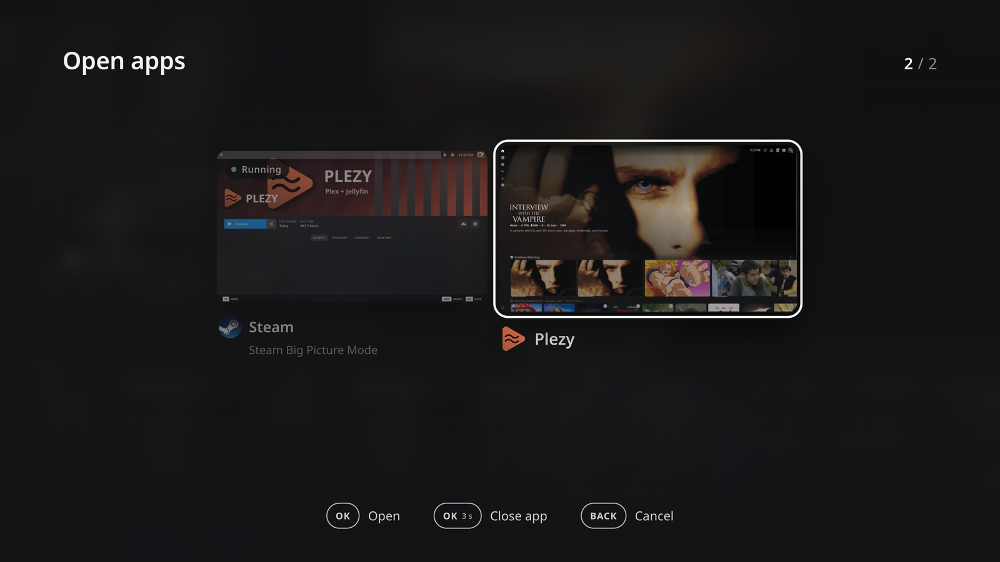

# G20S remote on Linux (KDE Plasma / Wayland)

Make the cheap **JZK G20S Pro Plus** air-mouse remote (2.4 GHz dongle) a real couch controller for a Linux living-room PC:
it turns the TV on and off, changes the **TV's** volume (not the PC's), jumps back to your media app, switches windows,
and opens a **TV-style app switcher** with a live screenshot of every open window, where you can also kill a frozen app.



Tested on **Bazzite** (Fedora Atomic) with **KDE Plasma 6.7 / Wayland**, a 4K TV, Steam Big Picture, Plezy and VacuumTube.
Nothing here needs `rpm-ostree` layering: everything lives in `~/.local`, `~/.config` and two files in `/etc/udev`.

## What the remote does

The remote sends ordinary keyboard keys. Some of them are things a desktop reacts to (Power suspends the PC, volume keys
change the PC's volume, Home opens a browser). `hwdb/61-g20s-remote.hwdb` moves those to keys nobody binds, and the small
daemon `g20d` (read-only on the device) runs the real actions.

| Remote key | Raw scancode | What the PC sees | Action |
|---|---|---|---|
| D-pad up/down/left/right | HID keyboard | arrow keys | normal navigation (Steam, Plezy, VacuumTube...) |
| **OK** (air mouse off) | `0xc0041` | `KEY_ENTER` (remapped from `KEY_SELECT`, which many apps ignore) | select |
| **Back** | `0xc0224` | `KEY_ESC` (remapped from `KEY_BACK`) | back: Steam Big Picture only understands Escape |
| **Power** | `0x10081` | `KEY_PROG1` | toggle the **TV** (Home Assistant webhook or your command) and pause any playing media |
| **Vol+ / Vol-** | `0xc00e9` / `0xc00ea` | `KEY_PROG2` / `KEY_PROG3` | TV volume (repeats while held) |
| **Mute** | `0xc00e2` | `KEY_PROG4` | TV mute |
| **Home** | `0xc0223` | `KEY_MACRO1` | raise your home app full screen, or start it |
| **1** | `0x7001e` | `KEY_MACRO2` | previous window (like Alt+Tab) |
| **3** | `0x70020` | `KEY_MACRO4` | next window |
| **2** | `0x7001f` | `KEY_MACRO3` | **app switcher**: open; press again to close (or raise it if it is behind); never two |
| **Mic** | `0xc00cf` | `KEY_VOICECOMMAND` | open the search of the app in front (Plezy: `Ctrl+F`) |
| Play/Pause, air mouse, Pg+/Pg-... | | unchanged | unchanged |

Why `KEY_MACRO1` for Home and not `F13`? On KDE, `F13` opens *Quick Settings*. `KEY_MACRO*` (0x290+) has no X11 keysym, so
nothing reacts to it except `g20d`.

## The app switcher

Press **2**. A full-screen page lists every open window as a card with a real screenshot, the app icon and the window title.

* **left / right** move, **OK** brings that window to the front (the switcher closes),
* **hold OK for 3 seconds** kills the selected app (SIGTERM, then SIGKILL if it does not answer; killing Steam relaunches Big Picture),
* **Back** closes the switcher, **2** again closes it too.

The interface is a single HTML page designed with [Claude Design](https://claude.ai/design) and served unmodified.
A tiny local server (`g20-switcher-server`, port 48765) lists windows through a KWin script that calls back over D-Bus,
takes the screenshots with KWin's `ScreenShot2` interface, and opens the page in Chrome/Chromium kiosk mode.

## Requirements

* KDE Plasma 6 on Wayland (the window scripts use KWin), `qdbus` (`qt6-tools`), systemd user services
* Python 3.11+ with PyGObject (`gi`) and Pillow, `curl`, `busctl`
* Chrome or Chromium (native or Flatpak) for the switcher
* `ydotool` + `ydotoold` (only for the Mic key), optional
* the remote's 2.4 GHz dongle (USB `4842:0001`). Other remotes: see *Adapting*.

## Install

```bash
git clone https://github.com/silkyclouds/g20s-remote-linux && cd g20s-remote-linux
./install.sh                 # user part: scripts, services, switcher (no sudo)
sudo ./install-system.sh     # system part: key remap + permission, then UNPLUG AND REPLUG THE DONGLE
```

Replugging the dongle is required after any change to the hwdb file: the kernel keymap is only rebuilt when the device appears.

Edit `~/.config/g20/g20.conf`:

```ini
# TV control: a Home Assistant webhook (see ha/automation.example.yaml) ...
G20_HA_WEBHOOK_URL=http://homeassistant.local:8123/api/webhook/YOUR_LONG_RANDOM_ID
# ... or your own command per action (HDMI-CEC, IR blaster, ...)
#G20_CMD_POWER=...
# Home button: which app to raise (window class substring), its process name and start command
G20_HOME_MATCH=plezy
G20_HOME_PROC=plezy
G20_HOME_CMD=plezy
```

Then `systemctl --user restart g20d`. Logs: `journalctl --user -u g20d -f`.

### Optional: idle power saving

`sudo ./eco/install-eco.sh` installs `g20-eco`, a root service that keeps the PC awake (a local Ollama keeps answering)
but sets the CPU to its lowest energy profile and turns turbo off after 90 s without video playback, game or inference,
and restores everything at the first activity. AMD `amd-pstate-epp` / Intel EPP only. `sudo systemctl stop g20-eco` restores the original setting.

## Using it with your apps

* **Steam Big Picture**: arrows, OK and Back work. Back must be Escape (that is why the hwdb remaps it). Key **2** shows Steam as a card; if you
  kill it, it is relaunched in Big Picture. Steam's own screensaver is not woken by this remote: disable it in Steam
  (Settings > Customization > Screensaver).
* **Plezy** (Plex/Jellyfin client): D-pad, OK and Back work, Home starts/raises it full screen, Mic opens its search page.
  Limitation: Plezy opens its on-screen keyboard only for a TV "select" key, and Linux reports this remote's OK as a keyboard Enter,
  so you can open the search but not type with an on-screen keyboard (a Bluetooth voice path is the real fix, see below).
* **VacuumTube** (YouTube TV client): D-pad, OK and Back work. The Mic key cannot open its search.
* Anything else: D-pad, OK, Back, window switching and the switcher work with every application that takes keyboard input.

## Voice search (not included)

The remote's microphone only works over **Bluetooth** (Android TV voice protocol, ATVV), not through the 2.4 GHz dongle.
The dongle and Bluetooth are two alternative modes of the remote, not simultaneous. If you pair it over Bluetooth, **all** keys
go over Bluetooth, and the key remaps need another hwdb match (the Bluetooth device has a different bus/vendor id; read it with
`g20-capture` and `udevadm info`). [ATVVoice](https://github.com/b0o/ATVVoice) exposes the mic as a PipeWire source; speech-to-text
(e.g. Whisper, French and English) can then type into the focused search box. This is not wired in this repository.

## Adapting to another remote

1. Find the device: `grep -r . /sys/class/input/event*/device/name`.
2. `sudo bin/g20-capture` (set `G20_DEVICE_NAME=...` for the device name) and press each key: it prints `MSC_SCAN` and the keycode.
3. Copy `hwdb/61-g20s-remote.hwdb`, change the `evdev:input:b0003vXXXXpYYYY*` line to your remote's USB ids and the scancodes.
4. `sudo ./install-system.sh`, replug, `systemctl --user restart g20d`.

## Troubleshooting

* A key still does the old thing: you did not replug the dongle after `install-system.sh`.
* `/dev/input/eventNN` numbers change on every replug: nothing here depends on them, devices are found by name.
* The switcher shows no screenshots: check `journalctl --user -u g20-switcher`; the authorization lives in
  `~/.local/share/applications/g20-switcher-shot.desktop` (run `kbuildsycoca6` after changing it).
* Nothing happens on a key: `journalctl --user -u g20d -f` shows what the daemon received.

## License

MIT. The switcher page is generated design output and is shipped unchanged.
