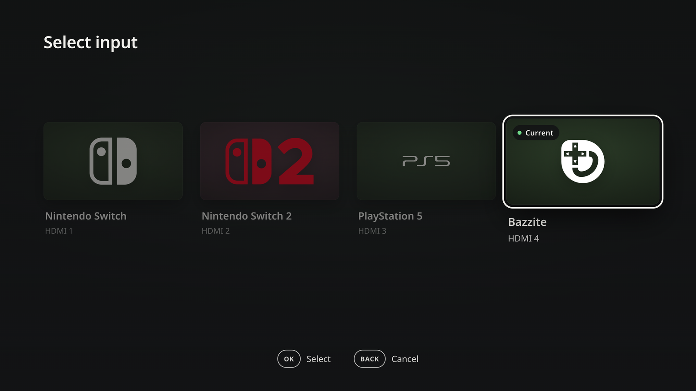
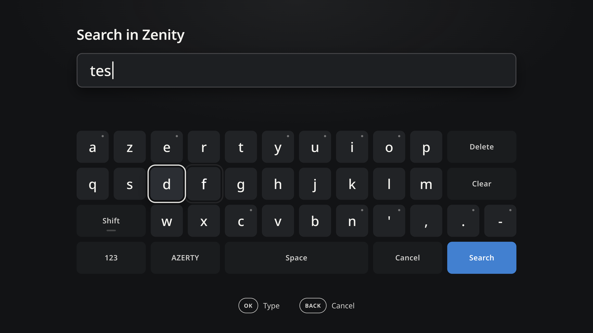
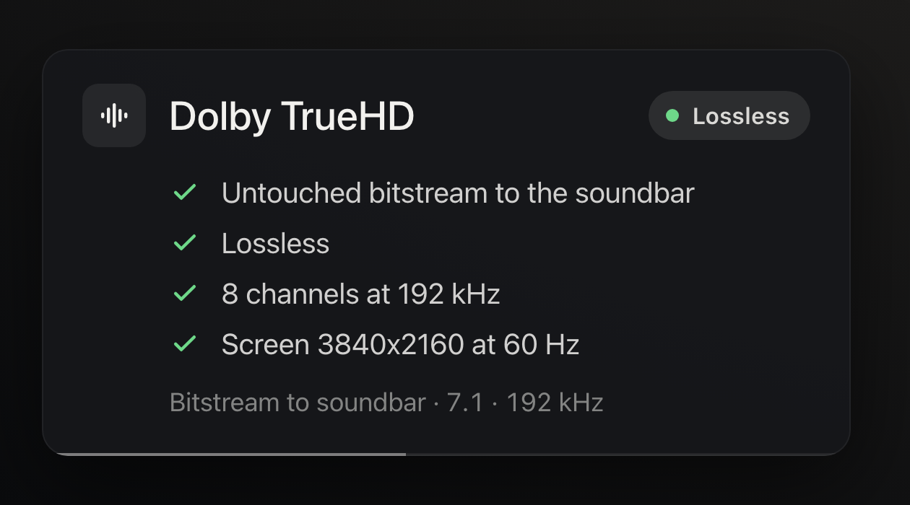
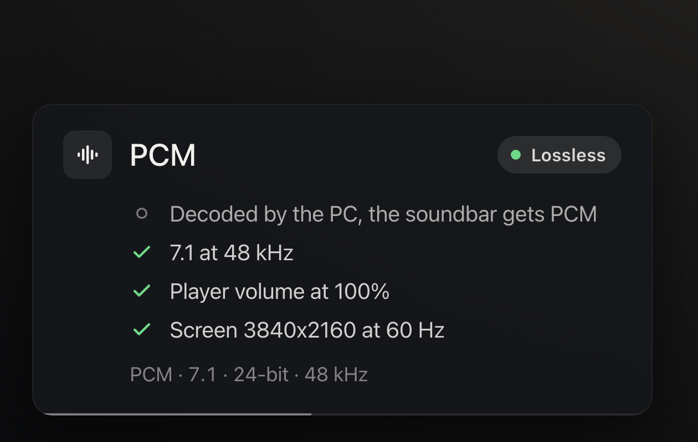
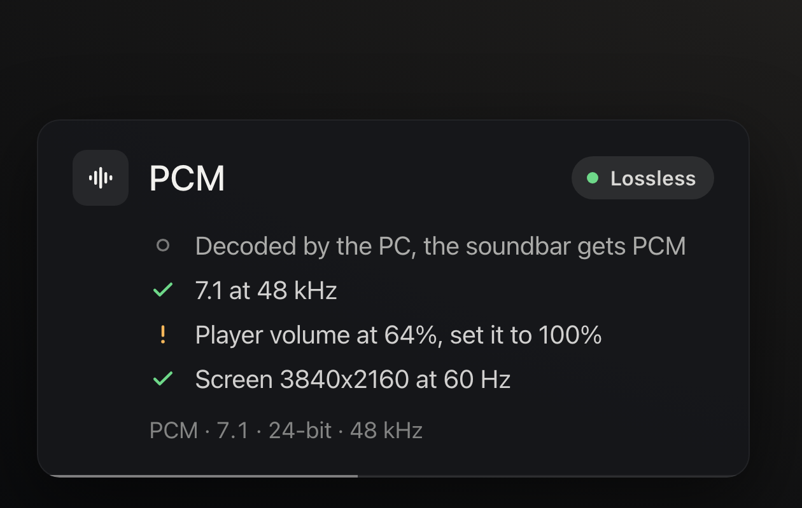
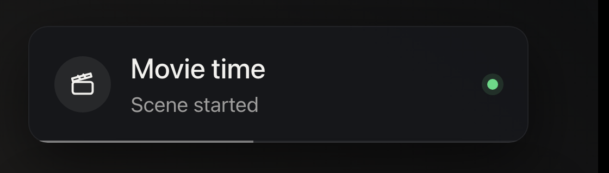
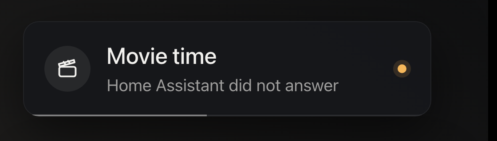

# Setup guide

From a fresh clone to a living-room PC that behaves like a streaming box. Every step says **what you do**, **what you should see**, and **what to do if you do not**.
Each optional feature can be skipped; nothing below is required except steps 1 and 2.

Contents: [1. Install](#1-install) - [2. Teach it your remote](#2-teach-it-your-remote) - [3. Control the TV](#3-control-the-tv-volume-power-input) -
[4. The pages: switcher, keyboard, input picker](#4-the-pages-switcher-keyboard-input-picker) - [5. Voice search](#5-voice-search) -
[6. Lossless sound and the quality checklist](#6-lossless-sound-and-the-quality-checklist) - [7. A scene button (Movie time)](#7-a-scene-button-movie-time) -
[8. Configuration reference](#8-configuration-reference) - [9. What it looks like, and ideas](#9-what-it-looks-like-and-ideas) - [10. Troubleshooting](#10-troubleshooting)

## What you need

* A Linux PC on **KDE Plasma 6 with Wayland** (tested on Bazzite, Fedora Atomic). The window scripts use KWin.
* A remote with a USB dongle or Bluetooth (written for the JZK G20S Pro Plus, any remote works: the wizard learns your buttons).
* Optional: **Home Assistant** (TV power / volume / input and scenes), a **soundbar or AV receiver** on HDMI (lossless sound), a Bluetooth adapter (voice).
* Programs used: `python3`, `systemctl`, `curl`, `busctl`, `qdbus`, and for some features `ydotool`, `wl-clipboard`, PipeWire (`pw-dump`), Chrome or Chromium,
  PySide6 with QtWebEngine (the on-screen notices). `install.sh` checks all of that and tells you what is missing.

## 1. Install

```bash
git clone https://github.com/silkyclouds/g20s-remote-linux && cd g20s-remote-linux
./install.sh
```

You should see `== checking what this computer has`, then the installation, then the wizard. A line starting with `MISSING (required)` stops the install and tells you what to install;
a line starting with `Missing (optional)` only means one feature will be limited. Nothing is installed outside your home folder, except two small files in `/etc/udev` written by the wizard.

## 2. Teach it your remote

The wizard starts by itself at the end of `./install.sh` (or any time: `sudo bin/g20-setup`).

1. *Press any button on your remote* (air mouse OFF, D-pad mode). It names your remote and shows the USB ids.
2. For each function it says `Press D-PAD UP ...`: press that button on the remote. If your remote has no such button, press **Esc** on the keyboard to skip.
3. It prints the key table it will write, then asks (optional) for a Home Assistant webhook, the voice languages and the keyboard layout. **Enter keeps the default.**
4. **Unplug and replug the dongle** (or reconnect the Bluetooth remote). Then press a few buttons on the remote to wake it up.

Check: `journalctl --user -u g20d -f` prints a line for each action (`tv volup 200` and so on). Redo only some buttons any time:

```bash
sudo bin/g20-setup --only source,switcher,scene      # the others keep their button
```

If a button does nothing right after replugging: press a few other buttons first. The remote's LED blinks red when it has not linked to the dongle yet; it takes a moment after a replug.

## 3. Control the TV (volume, power, input)

Power, volume and mute go to the **TV**, not to the PC. Choose one of two backends in `~/.config/g20/g20.conf`:

**A. Home Assistant (any TV Home Assistant can control).** Copy the automation of [`ha/automation.example.yaml`](../ha/automation.example.yaml) into your `automations.yaml`,
replace `REPLACE_WITH_A_LONG_RANDOM_ID` and the entity ids with yours, reload automations, then put the URL in the config:

```ini
G20_HA_WEBHOOK_URL=http://homeassistant.local:8123/api/webhook/YOUR_LONG_RANDOM_ID
```

Power behind a soundbar (soundbar first, then the TV, then the right input) has its own example with a separate webhook: [`ha/power-with-soundbar.example.yaml`](../ha/power-with-soundbar.example.yaml)
and `G20_HA_POWER_WEBHOOK_URL`.

**B. Any command** (HDMI-CEC, an IR blaster, `curl` to your TV's API):

```ini
G20_CMD_POWER=cec-client ...
G20_CMD_VOLUP=...
G20_CMD_VOLDOWN=...
G20_CMD_MUTE=...
```

Check: press Volume + on the remote; `journalctl --user -u g20d` shows `tv volup 200` (webhook answered) or `tv volup (command)`.

## 4. The pages: switcher, keyboard, input picker

They are small web pages shown full screen by Chrome/Chromium, served only on your PC (`127.0.0.1`). Nothing to configure except:

* **Home** opens your media app: `G20_HOME_MATCH` (window class), `G20_HOME_PROC` (process), `G20_HOME_CMD` (start command). Default: Plezy.
* **Input picker**: what is plugged in each HDMI input, shown with a logo. The wizard asks; later: `G20_SOURCES=hdmi1,hdmi2:PC,hdmi3:PlayStation,hdmi4` (id:label).
  Own logos: drop `name.svg` in `~/.config/g20/logos/`. With Home Assistant, set `G20_SOURCE_VIA_HA=1` so the key shows the picker when the TV is on the PC's input
  (`G20_PC_INPUT`, default `hdmi4`) and otherwise cycles the inputs; the HA side is the `source_key` part of the example automation.
* **Keyboard layout**: `G20_KEYBOARD_LAYOUT=azerty` (qwerty, azerty, qwertz).
* **Another browser**: `G20_BROWSER="flatpak run com.google.Chrome"` (the URL is added at the end).

## 5. Voice search

Needs a **Bluetooth** remote (the microphone only works over Bluetooth, never through the 2.4 GHz dongle) and a Bluetooth adapter.

```bash
./voice/install-voice.sh          # installs the microphone bridge and the speech engine
bluetoothctl                      # pair the remote once (scan on, pair, trust, connect)
sudo bin/g20-setup --only mic     # the Bluetooth remote has other ids than the dongle
```

Set the languages: `G20_VOICE_LANGS=fr,en` (first = default). With several languages the spoken one is detected among those only. `G20_VOICE_MODEL=small` (tiny to large-v3).
Hold the mic key, speak, release: the text lands in the on-screen keyboard.

## 6. Lossless sound and the quality checklist

For a PC behind a soundbar or receiver. The full method and what cannot be verified is in [media-center.md](media-center.md); the short version:

```bash
g20-audio-setup --profile surround71            # reports what your HDMI output announces and what it would change
g20-audio-setup --profile surround71 --apply    # does it (saved by WirePlumber, no root)
```

Then enable *passthrough* in your player (Plezy: Settings > Audio > Passthrough; mpv: `audio-spdif=ac3,eac3,dts,dts-hd,truehd`).
When a film starts, a small checklist appears at the bottom left for 6 seconds: untouched bitstream or not, codec, lossless or not, channels, rate, volume, screen mode
(see the pictures below). Settings: `G20_AUDIO_POPUP=0` to disable, `G20_AUDIO_POPUP_APPS=mpv,plezy,...` (which players trigger it), `G20_AUDIO_POPUP_SECONDS=6`.

Proof, not trust: while a film plays, `grep -H . /proc/asound/card*/pcm*p/sub0/hw_params` shows what really goes on the HDMI cable.

## 7. A scene button (Movie time)

One button of the remote starts a Home Assistant scene; a notice confirms it at the top right of the screen for 3 seconds.

1. Map the button: `sudo bin/g20-setup --only scene` (press the button, then give the name shown in the notice and the webhook URL, or a shell command).
2. In Home Assistant, create the automation of [`ha/scene.example.yaml`](../ha/scene.example.yaml): flavour **A** starts the scene; flavour **B** *toggles* (second press leaves the scene)
   and Home Assistant chooses the message ("Scene started" / "Back to the previous lighting"). For B add `G20_SCENE_NOTICE=ha` to the config and the `g20_notice` rest command from the example,
   plus `G20_REMOTE_SECRET` and `G20_HA_IP` (the PC only accepts that request from Home Assistant's address with the secret).
3. Check: press the button; `journalctl --user -u g20d` prints `scene <name> ok`, and the notice appears about two seconds later.

If Home Assistant does not answer, the notice turns amber: "Home Assistant did not answer".

## 8. Configuration reference

`~/.config/g20/g20.conf`, one `KEY=VALUE` per line, private (`chmod 600`). Restart the daemon after a change: `systemctl --user restart g20d`.

| Key | Meaning |
|---|---|
| `G20_DEVICE_IDS`, `G20_DEVICE_NAME` | the remote (written by the wizard) |
| `G20_HA_WEBHOOK_URL` | Home Assistant webhook for power / volume / mute / source |
| `G20_HA_POWER_WEBHOOK_URL` | separate webhook for Power (long sequences) |
| `G20_CMD_POWER`, `G20_CMD_VOLUP`, `G20_CMD_VOLDOWN`, `G20_CMD_MUTE`, `G20_CMD_SOURCE` | a shell command instead of the webhook |
| `G20_SOURCES`, `G20_PC_INPUT`, `G20_SOURCE_VIA_HA` | the input picker |
| `G20_HOME_MATCH`, `G20_HOME_PROC`, `G20_HOME_CMD`, `G20_HOME_FULLSCREEN` | the Home button |
| `G20_KEYBOARD_LAYOUT` | `qwerty`, `azerty` or `qwertz` |
| `G20_VOICE_LANGS`, `G20_VOICE_MODEL`, `G20_VOICE_DEVICE`, `G20_VOICE_AUTOSUBMIT` | voice search |
| `G20_SCENE_LABEL`, `G20_SCENE_WEBHOOK_URL`, `G20_CMD_SCENE`, `G20_SCENE_ICON`, `G20_SCENE_DETAIL`, `G20_SCENE_NOTICE` | the scene button |
| `G20_AUDIO_POPUP`, `G20_AUDIO_POPUP_APPS`, `G20_AUDIO_POPUP_SECONDS` | the quality checklist |
| `G20_REMOTE_SECRET`, `G20_HA_IP`, `G20_BIND` | letting Home Assistant call the PC (input picker, notices) |
| `G20_BROWSER` | browser used for the pages |
| `G20_ECO_DELAI` | idle power saving delay (see `eco/`) |

## 9. What it looks like, and ideas

| | |
|---|---|
|  | **App switcher**: cards of the open windows with live pictures. OK opens, OK held 3 s closes a frozen app, Back cancels. |
|  | **TV input picker**: choose the HDMI input with the D-pad; the TV switches through Home Assistant. |
|  | **On-screen keyboard** for searches, D-pad or air mouse, and voice if you set it up. |
|  | **Quality checklist** at the start of a film: an untouched Dolby TrueHD bitstream at 192 kHz, lossless, on a 4K 60 Hz screen. |
|  | The same card for a game or a decoded track: PCM 7.1, player volume 100 %. |
|  | And when something lowers the quality (here the player volume), it says so in amber. |
|  | **Scene notice** at the top right when you press the scene button. |
|  | Amber when Home Assistant did not answer. |

Ideas:

* **Movie night with one button**: the scene dims the lights over ten seconds, the checklist confirms the sound is an untouched TrueHD stream, the same button restores the lights at the end.
* **A streaming box for the family**: Home opens your media app, the keyboard types the search, Source switches between the PC, the console and the box without the TV remote.
* **Home Assistant as the hub**: any automation can show a message on the TV screen with the `g20_notice` rest command (a visitor at the door, the washing machine finished).
  Keep that for what really deserves to interrupt a film.
* **Game console mode**: Steam Big Picture with the Back key as Escape, the app switcher to jump between Steam and your media app, the idle saving to keep the PC quiet.

## 10. Troubleshooting

* **A button does nothing**: the dongle was not replugged after the wizard, or the remote has not linked yet (red blinking LED): press a few buttons. `journalctl --user -u g20d -f` shows what the PC receives.
* **The wizard says no remote found**: air mouse OFF (D-pad mode), press a button during the countdown, try the other USB port. Bluetooth: pair first with `bluetoothctl`.
* **Wrong action on a key**: rerun `sudo bin/g20-setup --only <function>`. Names: `up down left right ok back home power volup voldown mute mic play prev next source switcher prevwin nextwin scene`.
* **The notices do not appear**: `journalctl --user -u g20-switcher` and `systemctl --user status g20-toast@notice`. They need PySide6 with QtWebEngine and Plasma's LayerShellQt. Test by hand:
  `curl -X POST -H 'Content-Type: application/json' -d '{"title":"Test","detail":"Hello","status":"ok","icon":"scene","hold":3000}' http://127.0.0.1:48765/api/notice/show`.
* **The quality checklist does not appear**: `journalctl --user -u g20-audio-watch`; the player must be in `G20_AUDIO_POPUP_APPS`, and HDMI audio must be running.
* **TV volume does nothing**: `journalctl --user -u g20d` should show `tv volup 200`. Another number means Home Assistant refused: check the webhook id and `local_only`.
* **Uninstall**: `./uninstall.sh` (user part) then the two commands it prints for `/etc/udev`.
